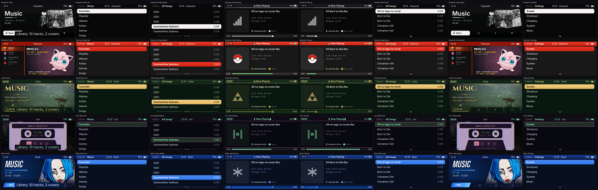

# Graysand

## NOTE: PLEASE USE AT YOUR OWN RISK. THIS PROJECT IS STILL IN EARLY DEVELOPMENT, AND I HAVE ONLY TESTED IT ON MY OWN DEVICE.

Graysand is custom firmware for the full-size Snowsky Echo (4 GB and 8 GB models, 480 × 222 screen). It replaces FiiO's software with anD custom interface:

- a music library built on the player from your tags
- gapless albums, Cover Flow, favorites, playlists and an Up Next queue
- audiobook and podcast bookmarks
- Bluetooth headphones and USB DAC mode
- five themes in one image

It is built on the work of Basil ([EchoPod](https://github.com/BasilSkyWalk/echopod)) and [Podium](https://podium-echo.online/), which ported EchoPod to the full-size Echo. The firmware still writes `PODIUM` into its image header, so the updater in earlier builds keeps accepting new images. [`CREDITS.md`](CREDITS.md) lists everyone and every license.

It is unofficial and comes with no warranty. Most of what is described here has been checked in the desktop simulator and in the firmware emulator, which runs the real image. The newest changes (the loaded code block, live blur and storage reporting) have not been tried on a real player yet.

## Features and themes

### Themes

Settings → System → Theme switches between five themes instantly: **Graysand** (the default), **Pokemon**, **Zelda**, **Lain** and **Noah**. Every theme draws its own headers, selection, row marks and backgrounds, not only its own colours.



Each row is one theme, from the firmware image itself: Home, the music list, the bottom of the song list, Now Playing, the volume popup, back on the list, Settings, and Home again.

| Theme | Background | Selection | Header text | Look |
|---|---|---|---|---|
| Graysand | `#101114` | `#2260D0` | white | Plain black and white, thin grey and white underline on the player header |
| Pokemon | `#12131A` | `#C4280A` to `#E3350D` | `#FFCB05` | Red header, Pokéball marks, yellow accents, HP-style progress bar |
| Zelda | `#090F0D` | `#B08C40` to `#DEBA66` | `#DEBA66` | Gold rules, Triforce marks, diamond trim on the timeline |
| Lain | `#060509` | `#964C74` to `#E296B2` | `#78FFA0` | Square outlines, green terminal text, scanlines, segmented bars |
| Noah | `#080A16` | `#1E60C8` to `#2C7CEC` | `#A8D8F8` | Deep blue gradients, cobalt accents, butterfly volume art |

Home can show album covers or the theme's emblem (Settings → Home art). With the emblem selected, Home stops loading and decoding covers.

The themes are fan colour schemes with simple shapes drawn in code. They contain no artwork from the works they're named after.

### Interface

The interface was redrawn to match a set of approved mock sheets, screen by screen, on all five themes:

- **Headers.** Navigation screens use a 29 px header: breadcrumb, title and divider. Battery and percentage sit on the right. The Now Playing header is 26 px, with a clock pill and per-theme decoration.
- **Lists.** One-line rows are 32 px, two-line rows 39 px and rows with covers 48 px. The selection is a rounded pill (square with an outline on Lain). Long lists fade out at the bottom and finish with a "the end" marker.
- **Albums.** Albums open as a list or a 5-column grid (Settings → Album view). The album page shows the cover, title, artist, year and song count, with the track list beside them.
- **Settings.** Choice screens (Theme, Player style and so on) mark the current option with a check in the theme's accent colour.

### Now Playing

Settings → Player style picks one of three layouts:

- **Album cover.** Cover on the left, file name and lyrics on the right, artist and album underneath, timeline at the bottom. When an `.lrc` file sits next to the track and Settings → Lyrics is on, five lines of lyrics scroll in time with the current line highlighted.
- **Cassette, full screen.** A full-screen cassette drawn from theme art, with the file name, artist, album, times and format filled in live.
- **Cassette, minimal.** A smaller cassette with the normal header and timeline.

Settings → Format info adds a small tag beside the file name with the codec and sample rate, for example `FLAC | 24/192`. Long file names scroll inside their box and don't run into the tag.

The footer is drawn per theme from one small table: gradient, rule line, track style and knob.

The cassette and volume screens are pictures read from the card (see [Theme art on the card](#theme-art-on-the-card)). If the files aren't there, the player falls back to the album cover layout.

### Volume overlay with live blur

Pressing a volume key on Now Playing blurs the page underneath and draws the theme's volume art on top. The blur is computed live from the current frame, not from a stored picture (`src/app/volume_blur.c`):

1. While the page draws, every 8 × 8 block of pixels is averaged into a 60 × 28 low-resolution copy.
2. While the overlay is up, each row is replaced by that copy, scaled back up with bilinear filtering and dimmed by half.
3. The screen is drawn in strips, so the blur always reads the previous frame's copy. That keeps strip edges seamless but means the backdrop lags one frame behind.

The two low-resolution buffers and their sums take about 7 KB of RAM. The volume art is keyed: pixel value 0 is transparent and lets the blur through, so real black is stored as `0x0020`.

### Fonts

The interface uses Inter. Besides the four original faces (regular 16 and 22, semibold 16 and 22) there are 24 sized faces: regular and semibold at every pixel size from 7 to 18 (`inter_regular_7_sized` through `inter_semibold_18_sized`).

They are pre-rendered into the glyph pack (`assets/fonts/glyph_pack.json`) and streamed from the firmware image as needed, like the older faces. `font_sized(pixels, bold)` in `src/gfx/font_sized.c` returns one. Art files ask for a font with a one-byte size code: pixel size, with bit 7 set for semibold.

### Storage information

Settings → System → Information shows the firmware version and build, the library counts, and two storage cards: **Internal storage** and **SD card**. Each card shows used and total space (for example "9.8 GB of 16 GB") with a bar.

The numbers are measured during a library rescan, in the rescan code that runs from high RAM (see [Memory layout](#memory-layout)), and only by reading. Nothing is written to either filesystem except the result.

| Filesystem | How free space is found |
|---|---|
| FAT32 | The free-cluster count in the FSInfo sector. If it's missing or out of range, the value is reported as unknown rather than guessed |
| FAT16 | Counts the free entries in the FAT |
| exFAT | Counts the clear bits in the allocation bitmap |

Both results are stored at offset 2048 of `/.echo/rescan_times.bin`, which Information reads when it opens. Counting the whole FAT on a big FAT32 volume made the first boot too slow in the emulator's cold-boot tests, which is why FAT32 trusts FSInfo instead. The code is in `platform/device/logic/fat_space.c`.

### Other features

- Start screen choice, Music menu (Favorites, Playlists, Albums, Artists, Genres, Songs).
- Shelves for top-level `Audiobooks`, `Podcasts` and `Quran` folders, with saved positions. Podcasts can sit with Books or on their own shelf.
- Equalizer presets (Off, Retro, Bass, Heavy, Pop, Jazz, Unique), DAC filter, balance, gain, volume limit (Off, 40, 30, 20), swappable volume keys and fast forward from 5 to 15 s.
- Output choice: Auto, 3.5 mm or 4.4 mm.
- USB mode: Computer (show the player's drives) or Normal USB.
- Bluetooth headphones, an Up Next queue, a file browser and a stopwatch.

## Installation, updating and recovery

### Installing

You only need the player, its cable and a computer.

1. Download `ECHOV460.IMG` from the repo's latest release. It is 5,242,884 bytes.
2. Check it against the SHA-256 in the release notes: `Get-FileHash ECHOV460.IMG` in PowerShell, `shasum -a 256 ECHOV460.IMG` on macOS or Linux. If it differs, download it again.
3. Charge the player and copy anything you want to keep off its internal storage.
4. Connect it. Copy `ECHOV460.IMG` to the top level of the internal storage drive, not into a folder, with no other `ECHOVnnn.IMG` beside it.
5. Eject the drive and unplug.

**From FiiO's firmware**, the player shows "Updating" for a minute or two, installs, deletes the file and restarts into the new firmware.

**From an earlier build**, it shows "Installing update" with a percentage, then "Update installed". Unplug, hold Power for two seconds to switch off, then switch on.

If FiiO's firmware comes back after a very short "Updating" and the file is gone, nothing was written. Copy the file again onto a drive with more free space.

Later updates install the same way. Settings, favorites and the library are kept.

### Theme art on the card

The cassette screens, the volume overlay, the Information card art and some Home pictures are raw RGB565 pictures read from `/.echo/` on the card, kept per theme in `full/`, `player/`, `volume/`, `info/`, `home/` and `bye/`. They are not built by this repository, so copy them onto the card yourself. Screens whose art is missing fall back to the layouts drawn in code, and the volume overlay is not shown at all.

### Going back to FiiO's firmware

1. Download the Echo firmware from FiiO's website and unzip it. The image is `ECHOV200.IMG` (V2.0.0), 39,845,892 bytes.
2. Copy it unchanged to the top level of internal storage, with no other image beside it. Eject and unplug.
3. The player shows "Installing FiiO firmware", then "FiiO firmware installed". Take the card out and switch off and on. FiiO's firmware then installs the file once more.

To move to another custom firmware, go back to FiiO's first.

### If the player won't start

Before experimenting, put a file named `MASKROM.REQ` containing the text `MASKROM REQ` on internal storage. At the next start the firmware reboots once into the chip's USB loader, the same state as the key combination below.

The firmware also enters the loader by itself if its loaded code block (see [Memory layout](#memory-layout)) fails validation. It shows "Firmware damaged" for five seconds, then reboots into the loader.

Without either, use the loader's USB mode. Podium reports that these steps brought a full-size Echo 4 GB back to FiiO's V2.0.0 from macOS. **They have not been run with Graysand or by its author.** [docs/recovery-full-size-echo.md](docs/recovery-full-size-echo.md) has the full procedure, the evidence for each step and what is still unknown. FiiO's loader enters this mode when USB power is present and the key input reads low at start, which is what holding every button except Power does.

1. Unplug USB and press the RST hole with a paperclip so the player is fully off.
2. Hold every button except Power, plug the cable in, and let go after 2 to 3 seconds. The screen stays black and the computer sees USB device `2207:262D`.
3. On Windows, bind that device to WinUSB once with [Zadig](https://github.com/pbatard/libwdi/releases). Bind only that device: check both numbers.
4. Use [rkdeveloptool](https://github.com/rockchip-linux/rkdeveloptool) patched for the Echo by `tools/patch_rkdeveloptool.py`. Never use an unpatched build. `rkdeveloptool ld` must list the device, then `rkdeveloptool td` must print `Test Device OK.`
5. Write FiiO's image back with `rkdeveloptool wl 0 ECHOV200.IMG`, then restart with `rkdeveloptool rd`.

## Music, library and playback

Copy music to a microSD card (FAT32 or exFAT) in any folder layout. Without a card the player uses internal storage.

- **Formats:** FLAC, MP3 and WAV up to 192 kHz, and `.m4a` with AAC-LC or Apple Lossless. MP3 and AAC are decoded on the player's second core.
- **Covers:** art embedded in the first track, or a `cover`, `folder`, `front` or `albumart` JPEG or PNG beside it.
- **Playlists:** `.m3u` files work anywhere on the card.
- **Lyrics:** an `.lrc` file with the same name as the track.
- **Shelves:** top-level `Audiobooks`, `Podcasts` and `Quran` folders get their own shelves.

After you eject, the player notices the changes and rescans. Settings → Rescan library does it on demand. The rescan also refreshes the storage numbers on Information.

A separate `music` app (not part of this folder) downloads, tags and copies music onto the card.

## Building, development and testing

You need CMake, Ninja, Clang or GCC, SDL2, clang-format, the `arm-none-eabi` GCC toolchain and Python 3.

```sh
python3 -m venv .venv && .venv/bin/pip install -r tools/requirements.txt
cmake --preset dev && cmake --build --preset dev
cmake --preset release && cmake --build --preset release
```

The image lands in `build/release/ECHOV460.IMG`. The version is `PODIUM_VERSION` in `CMakeLists.txt`, and it also names the file. A `device` preset builds the same firmware with the developer Diagnostics rows left in.

**Windows:** use the MSYS2 CLANG64 shell with `mingw-w64-clang-x86_64-{clang,compiler-rt,cmake,ninja,SDL2,clang-tools-extra}` and `mingw-w64-clang-x86_64-arm-none-eabi-{gcc,binutils,newlib}`. Set `CMAKE_GENERATOR=Ninja CC=clang` for the `dev` preset, and use `.venv\Scripts\pip`. The byte-for-byte checks of generated fonts and tables are switched off there by `ECHO_CHECK_GENERATED`, because they need the reference macOS tools.

### Simulator

`build/dev/platform/sim/echo_sim --card <music folder> --system-dir build/system` runs the desktop simulator.

| Key | Player button |
|---|---|
| Arrow keys | Volume rocker |
| Return | Play |
| Tab | Menu |
| Backspace | Back |
| P | Power |

`--headless --keys down,play --screenshot shot.bmp` scripts it. `--frames`, `--scale`, `--battery`, `--charging` and `--record` are also available. In the simulator, Information shows fixed sample storage values.

Every push makes GitHub Actions build the release image and attach it, with its SHA-256, to the `v0.1.0` release ([`.github/workflows/release.yml`](.github/workflows/release.yml)). That build uses Ubuntu 24.04's GCC 13.2 and carries the commit as its build tag, so its bytes differ from an image built with another compiler or from another commit. The same compiler, source and tag give the same bytes.

### Adding a theme

1. Add a value at the end of `ThemeChoice` in `settings.h`.
2. Add its colours and a `THEMES` entry in `src/app/default_theme.c`.
3. Add its name to `THEME_OPTIONS` in `src/app/settings_screens.c`.
4. For its own header, row marks and backdrop, add a value to `ThemeStyle` in `theme.h` and draw it in `src/ui/theme_style.c`. Draw only inside the canvas clip, since the screen is drawn in strips.
5. Give it an emblem in `src/app/home_emblem.c`.
6. Build and look at it in the simulator.

New settings go at the end of their enum, so saved settings stay valid.

## Memory layout

The player's CPU is a Cortex-M3 in a Rockchip RKnano chip, with all code and data in on-chip RAM. The linker script is `platform/device/board/echo_device.ld`.

| Region | Address | Size | Holds |
|---|---|---|---|
| EXTRA_RAM | `0x03046A00` | `0x3800` | The loaded code block |
| CODE_RAM | `0x03050000` | `0x2666C` | The resident firmware |
| HIGH_RAM | `0x0307A000` | `0x18000` | Decode buffers during playback, the rescan code while rescanning |

### CODE_RAM and EXTRA_RAM

CODE_RAM is the only code the boot ROM loads. Its size is fixed by the boot ROM and can't grow, and the new interface no longer fit in it.

EXTRA_RAM is unused RAM below CODE_RAM, ending under the limit of `.data`, `.bss` and `.noinit` at `0x0304A240`. Code there runs like any other, but the boot ROM doesn't know about it, so the firmware loads it itself at startup.

These files live in EXTRA_RAM: `now_playing_screen.c`, `info_screen.c`, `volume_blur.c`, `font_sample_screen.c`, `stopwatch_screen.c` and `test_pattern_screen.c`. They are compiled without LTO in cross builds, so the linker script can find them by object name and put their code and constants in the `.extra` section. Boot, USB, updater and recovery code stays in CODE_RAM.

The release build uses 151,812 of 157,292 bytes of CODE_RAM (about 5.4 KB free) and 9,216 bytes of `.extra`'s 14 KB with GCC 13.2, and 152,732 and 8,704 with GCC 16.2.

### Loading and validation

`tools/make_image.py` takes `.extra` from the ELF and refuses one that isn't linked at `0x03046A00` or runs past `0x0304A240`. It writes the block at image offset `0x218000`: a 512-byte header sector (magic `EXTR`, size, CRC32), then the code.

At startup, after the glyph pack is attached, `board_extra_start()` in `platform/device/board/overlay.c`:

1. reads the header sector from the running image slot on the eMMC
2. checks the magic, and that the size equals the linked size of `.extra`
3. reads the code into EXTRA_RAM
4. checks its CRC32, the same CRC the rescan code uses

It tries three times. If every attempt fails, it fills EXTRA_RAM with `bx lr` instructions and returns false. The firmware then shows "Firmware damaged" and reboots into the USB loader before the app starts. The `bx lr` fill is only a backstop in case that path were ever bypassed. The CRC catches damage in storage, not a block that was built wrong.

### Image layout

The image is 5,242,884 bytes: one 5 MiB firmware slot plus a 4-byte CRC. The rescan code sits at `0x200000` (header `EOVL`), the loaded code block at `0x218000` (header `EXTR`, up to `0x8000`), and glyph faces fill the gaps. The glyph region that used to start at `0x218000` now starts at `0x220000` to make room.

## Project structure, credits and license

| Path | What it holds |
|---|---|
| `src/` | The portable app in C11, no heap |
| `platform/device/` | Player drivers, second-core decoders, startup, linker script and rescan overlay |
| `platform/sim/` | The SDL2 simulator |
| `tools/` | Image builder, emulator, benchmark, library and font tools |
| `assets/` | The Inter font and the glyph pack description |

### Known limitations

- Storage numbers update only on a rescan and show "Unknown" until the first one.
- On FAT32 the free space comes from FSInfo, which can be stale if a computer didn't update it.
- Without the theme's volume art on the card, a volume change shows no indicator on Now Playing.
- The blur works in 8 × 8 blocks, so it's softer and blockier than a true Gaussian blur.
- The loaded code block and its recovery path have only been tested in the emulator.

### Credits and license

The firmware comes from EchoPod by Basil and [Podium](https://podium-echo.online/). Much of the hardware knowledge comes from [ReChord](https://github.com/brnomt/ReChord). [`CREDITS.md`](CREDITS.md) has the full list.

GPL-3.0-or-later ([`LICENSE`](LICENSE)). The Inter font is under the SIL Open Font License (`assets/fonts/inter/OFL.txt`), libmad and FAAD2 under GPL-2.0-or-later, and dr_libs is public domain or MIT-0.

Snowsky and FiiO are trademarks of their owners and have nothing to do with this firmware.

## Support

If Graysand is useful to you, you can support it on Ko-fi:

[](https://ko-fi.com/E1E01DZ4X3)
